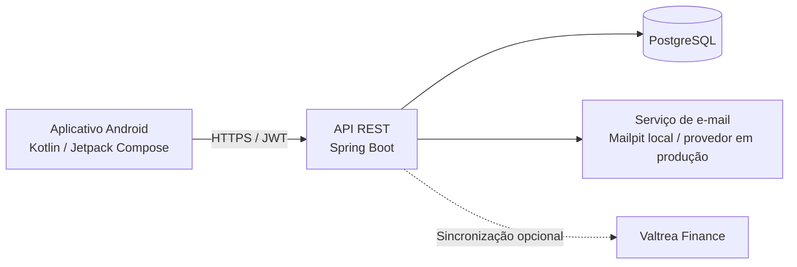

# Valtrea Pay

**Carteira digital experimental com aplicativo Android, API REST e integração com o Valtrea Finance.**

Um projeto de engenharia de software voltado à construção de uma carteira digital: cadastro e autenticação, consulta de saldo, busca de contatos, transferências entre usuários, extrato e sincronização opcional com um sistema de finanças pessoais.

**Site institucional:** [Valtrea](https://www.valtrea.com.br/) · **Repositório:** [adolfo-araujo/valtrea-pay](https://github.com/adolfo-araujo/valtrea-pay)

> **Atenção — ambiente de demonstração:** os depósitos descritos neste repositório são destinados ao *sandbox*. O projeto não possui, nesta versão documentada, entrada de dinheiro real via Pix ou processamento de cartões. Não utilize o sistema para movimentar recursos financeiros reais sem a infraestrutura, as integrações, as verificações de segurança e os requisitos regulatórios apropriados.

## Visão geral

O Valtrea Pay permite que usuários criem uma conta, confirmem o e-mail e realizem transferências entre carteiras de demonstração. O aplicativo usa uma API em Java/Spring Boot para processar as operações e registrar os lançamentos em PostgreSQL.

O projeto surgiu a partir do exercício **PicPay Clone**, da mentoria DIO (API Spring Boot e app Android de 2020), e foi reestruturado com tecnologias e decisões de implementação próprias, sob a identidade da Valtrea.

### Funcionalidades

| Área | Recursos documentados |
| --- | --- |
| **Conta e acesso** | Cadastro, login, confirmação de e-mail, recuperação de senha, encerramento de sessão e renovação de tokens |
| **Carteira** | Consulta de saldo e depósitos fictícios apenas no modo de demonstração |
| **Transferências** | Envio entre usuários por destinatário, incluindo busca de contatos e identificação por QR Code/link |
| **Extrato** | Consulta paginada de transações |
| **Proteção de operações** | Verificação de saldo, débito/crédito atômicos e idempotência para evitar cobranças duplicadas |
| **Integração opcional** | Registro de pagamentos enviados e recebidos no Valtrea Finance |
| **Privacidade** | Exportação dos próprios dados em JSON, aceite de termos e controles de acesso |
| **Administração** | Indicadores agregados, restritos a administradores |

## Tecnologias

| Componente | Tecnologias |
| --- | --- |
| **Backend (`api/`)** | Java 21, Spring Boot 4.1, Spring Security, JWT, Spring Data JPA, Flyway e springdoc/OpenAPI (Swagger) |
| **Banco de dados** | PostgreSQL 18 |
| **Testes da API** | Testcontainers, testes de integração e Maven |
| **Android (`android/`)** | Kotlin 2.4, Jetpack Compose / Material 3, Navigation, Retrofit 3, kotlinx.serialization e DataStore |
| **Build Android** | Android Gradle Plugin 9.4 e Gradle 9.8 |
| **Ambiente local** | Docker Compose e Mailpit |
| **Hospedagem descrita** | Render (API) e Neon (PostgreSQL) |

*As versões acima correspondem à documentação do projeto apresentada neste repositório; consulte os arquivos de build para confirmar eventuais atualizações.*

## Arquitetura



A API concentra autenticação, autorização e regras de negócio. As transferências validam o saldo antes do débito e registram o crédito ao destinatário como parte da mesma transação de banco. A chave de idempotência permite identificar tentativas repetidas de uma mesma operação.

### Estrutura do repositório

```text
valtrea-pay/
├── api/             # Backend Spring Boot e testes
├── android/         # Aplicativo Android em Kotlin
├── compose.yaml     # Serviços locais: API, banco e e-mail de testes
├── render.yaml      # Definição de implantação da API
└── README.md        # Visão geral e instruções
```

## Executando localmente

### Pré-requisitos

- Docker Desktop (para API, banco e serviços de desenvolvimento)
- Android Studio (para executar o aplicativo)
- Java 21 e Maven, caso queira executar a API e os testes fora do Docker

### 1. Inicie o backend e o banco

Na pasta raiz do projeto:

```bash
docker compose up -d --build
```

Serviços locais documentados:

| Serviço | Endereço |
| --- | --- |
| API | [http://localhost:8080](http://localhost:8080) |
| Documentação Swagger | [http://localhost:8080/swagger-ui.html](http://localhost:8080/swagger-ui.html) |
| Mailpit (e-mails de teste) | [http://localhost:8025](http://localhost:8025) |

O Mailpit recebe mensagens localmente; elas não são enviadas à internet.

### 2. Execute o aplicativo Android

1. Abra a pasta `android/` no Android Studio.
2. Inicie um emulador Android e execute a configuração **debug**.
3. No emulador, o endereço `http://10.0.2.2:8080` aponta para a API executada no computador.
4. Crie duas contas de demonstração e confirme os e-mails usando os códigos disponíveis no Mailpit.
5. Com o modo sandbox configurado, utilize o depósito de teste e faça uma transferência entre as contas.

Para testar em um celular físico, configure a URL de desenvolvimento para o IP local do computador e ajuste a configuração de segurança de rede do aplicativo somente para esse ambiente.

> **Configuração sensível:** não salve chaves JWT, senhas de banco, chaves de criptografia ou tokens de serviços externos no código-fonte. Utilize variáveis de ambiente/segredos do provedor. A opção `VALTREA_SANDBOX=true` deve ser restrita ao ambiente de desenvolvimento/testes.

## API REST

As rotas são prefixadas por `/api/v1`. As operações privadas exigem um token no cabeçalho `Authorization: Bearer <accessToken>`, exceto as rotas de autenticação e confirmação de e-mail que permitem acesso anônimo conforme sua finalidade.

| Método | Rota (após `/api/v1`) | Finalidade |
| --- | --- | --- |
| `POST` | `/auth/cadastro` | Criação de conta e carteira |
| `POST` | `/auth/login` | Autenticação com e-mail e senha |
| `POST` | `/auth/renovar` | Renovação da sessão com refresh token |
| `POST` | `/auth/sair` | Encerramento da sessão |
| `POST` | `/auth/confirmar-email` | Confirmação de e-mail |
| `POST` | `/auth/reenviar-confirmacao` | Reenvio do código de confirmação |
| `POST` | `/auth/esqueci-senha` | Solicitação de recuperação de senha |
| `POST` | `/auth/redefinir-senha` | Redefinição da senha com código |
| `GET` | `/eu` | Perfil e saldo autenticados |
| `GET` | `/eu/dados` | Exportação dos próprios dados em JSON |
| `POST` | `/eu/termos` | Registro do aceite dos Termos |
| `GET` | `/contatos?busca=` | Busca de destinatários |
| `GET` | `/contatos/{id}` | Consulta de destinatário por identificação |
| `POST` | `/transferencias` | Transferência entre carteiras; aceita `Idempotency-Key` |
| `GET` | `/transacoes?pagina=&tamanho=` | Extrato paginado |
| `POST` | `/depositos` | Depósito fictício (**somente sandbox**) |
| `GET`, `PUT`, `DELETE` | `/integracoes/finance` | Estado, conexão e desconexão do Finance |
| `GET` | `/admin/metricas` | Indicadores agregados para administradores |

Para os esquemas de entrada e saída, consulte o Swagger após iniciar a API.

## Integração com o Valtrea Finance

A integração opcional permite visualizar operações do Pay no controle financeiro pessoal:

- **Transferência enviada:** registrada no Finance como despesa.
- **Transferência recebida:** registrada no Finance como receita.
- **Depósito de teste:** apenas movimenta o saldo da carteira e **não** é contabilizado como receita.

O vínculo é feito por um código gerado no painel do Finance e informado no aplicativo Pay. Conforme a documentação do projeto, o Finance armazena apenas um hash do código e o Pay mantém a informação protegida por criptografia AES-256-GCM.

As notificações de transferência são colocadas em uma fila de envio assíncrona, com retentativas graduais, e usam identificadores externos para evitar lançamentos duplicados. A ausência temporária do Finance não deve desfazer uma transferência já concluída no Pay.

**Configuração relacionada:** `VALTREA_FINANCE_URL` (opcional; desabilita a integração quando vazia) e `VALTREA_CHAVE_CIFRA`. Não publique os valores reais dessas variáveis.

## Segurança e integridade

O projeto documenta as seguintes proteções:

- Senhas processadas com mecanismo de hash apropriado e autenticação JWT.
- Access token de curta duração e refresh token com renovação e invalidação para reduzir reutilização indevida.
- Bloqueio temporário de login após tentativas incorretas e recuperação de acesso por código de e-mail.
- Valores monetários processados com `BigDecimal` / `NUMERIC(19,2)`, evitando cálculos financeiros com ponto flutuante binário.
- Débito e crédito realizados em uma transação de banco, com proteção contra operações concorrentes.
- `Idempotency-Key` para evitar que o reenvio da mesma requisição execute a transferência novamente.
- Busca de contatos com informações limitadas, sem expor CPF, telefone ou saldo de outras pessoas.
- Migrações versionadas via Flyway, políticas de sessão e uso de HTTPS na configuração de produção.

**Nota:** esses controles são descritos no projeto; esta documentação não representa auditoria independente, certificação de segurança ou autorização para operar como instituição financeira.

## Testes

Com **Java 21**, **Maven** e **Docker** disponíveis, execute na pasta da API:

```bash
cd api
mvn verify
```

Os testes documentados usam Testcontainers com PostgreSQL e cobrem cenários como cadastro, autenticação, transferências, tentativas repetidas, concorrência, saldo, recuperação de senha, restrições de login e integração com um serviço simulado do Finance.

O projeto também documenta uma pipeline de integração contínua para execução de testes da API e build do aplicativo. Consulte os workflows do repositório para verificar sua configuração e os resultados mais recentes.

## Publicação

A implantação descrita para o backend utiliza **Render** e **Neon**:

1. Criar um banco PostgreSQL no Neon.
2. Configurar o serviço no Render a partir de `render.yaml`.
3. Informar as variáveis de conexão (`DATABASE_URL`, `DATABASE_USER` e `DATABASE_PASSWORD`) e as credenciais do serviço de e-mail, conforme a configuração da aplicação.
4. Configurar opcionais como `SENTRY_DSN`, `VALTREA_ADMIN_EMAILS` e a integração com o Finance, quando aplicável.
5. Confirmar a inicialização do serviço pelo endpoint de saúde documentado no projeto.

O aplicativo Android utiliza configurações distintas para **debug**, **prévia** e **release**. A publicação na Google Play consta como etapa futura do projeto — não deve ser confundida com a existência do módulo Android no repositório.

## Evolução do projeto

**Entregas descritas na documentação:** recuperação de senha, renovação de sessão, testes de integração, integração com o Valtrea Finance, melhorias de privacidade e controles contra duplicidade de transferências.

**Próximos passos:** integrar um provedor autorizado para entrada de dinheiro real, caso o produto avance para esse uso, e preparar a distribuição do aplicativo pela Google Play.

## Autoria e referências

**João Adolfo — Valtrea**  
Projeto de estudo e desenvolvimento de software baseado inicialmente no exercício *PicPay Clone* da mentoria DIO, posteriormente reestruturado com arquitetura e funcionalidades próprias.

---

